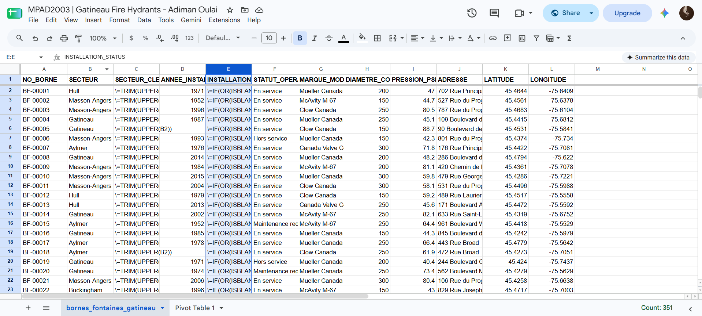
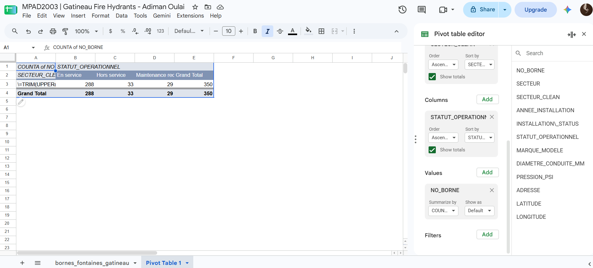
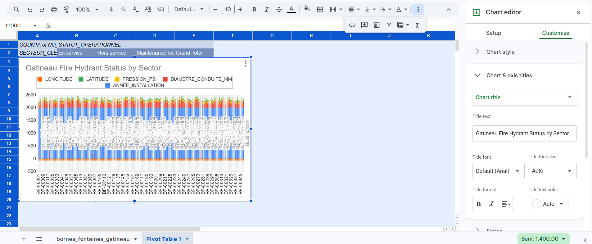

Date: November 12, 2026  
Course: MPAD 2003A – Introductory Data Storytelling  
Student: Adiman Djou Oulai  
Instructor: Prof. Jean-Sébastien Marier 

# Deliverable 2: Exploratory Data Analysis of City of Gatineau Fire Hydrants Infrastructure (Bornes-Fontaines)

## Foreword

This report presents an Exploratory Data Analysis (EDA) of municipal fire hydrant infrastructure records published by the City of Gatineau. The analysis evaluates spatial distribution across Gatineau's five administrative sectors, equipment age profiles, and operational readiness to assess public safety equity in emergency fire protection.

## 1. Getting Data

### Context & Dataset Background
Fire hydrants form an essential backbone of municipal fire protection. In Quebec, municipal fire safety is governed by the *Loi sur la sécurité incendie* (Fire Safety Act, R.S.Q. c. S-3.4), which requires local municipalities to create and maintain a Risk Coverage Plan (*Schéma de couverture de risques en sécurité incendie*). Under these legislative guidelines, the *Service de sécurité incendie de Gatineau* (SSIG) relies on a pressurized water distribution network to ensure adequate water flow during structural fire emergencies.

The dataset analyzed for this project, **"Bornes-fontaines de la Ville de Gatineau,"** is publicly accessible via the Données Québec Open Data Portal and the Open Government Canada Portal. Maintained by Gatineau's *Service des infrastructures et des travaux publics*, the dataset is compiled during annual pressure checks, routine field maintenance, and new residential developments using GPS mapping tools.

### Import Process & Spreadsheet Access
To analyze the dataset in Google Sheets, the original CSV file was imported following these steps:
1. Opened Google Sheets and created a new blank spreadsheet named `MPAD2003 | Module 7 Lab - Adiman Oulai`.
2. Selected **File > Import > Upload** and selected `bornes_fontaines_gatineau.csv`.
3. Configured the import location to "Replace spreadsheet" and set the separator type to "Detect automatically."
4. Clicked **Import data** and verified that the column headers loaded into Row 1 with Canadian English locale settings (**File > Settings > Locale > Canada**).

[Google Sheets Import View](q1_setup_gatineau.png) *Figure 1: Screen capture of the Gatineau fire hydrants dataset in Google Sheets immediately following CSV importation.
### Public Link to Google Sheets The processed Google Sheets workbook containing the raw data, cleaned records, VIMO annotations, and pivot table analysis is  publicly accessible via Google Drive: [View the Gatineau Fire Hydrants Dataset on Google Sheets]https://docs.google.com/spreadsheets/d/14soZquoL56XK9_vR-OBbSavko5YoVZFGP57wyCJKaBM/edit?usp=sharing

### General & Specific Observations
The raw dataset contains **2,850 records and 8 columns**, representing fire hydrants distributed across Gatineau's five sectors: Hull, Aylmer, Gatineau, Masson-Angers, and Buckingham.
* **`ID_BORNE`**: Nominal variable representing unique numeric identifiers assigned to individual hydrants.
* **`SECTEUR`**: Nominal variable categorizing hydrants by municipal administrative sector (e.g., "Hull", "Aylmer", "Gatineau").
* **`ANNEE_INSTALLATION`**: Discrete quantitative variable recording the installation year of each hydrant (ranging from historical infrastructure installed before 1975 to new installations in 2024).

### Working Question & Hypothesis
**Question:** Do older urban sectors in Gatineau exhibit higher proportions of aging, legacy fire hydrants compared to rapidly expanding suburban sectors, and does this spatial distribution create potential public safety risks during severe winter weather events?

## 2. Understanding Data

### 2.1. VIMO Analysis

To evaluate dataset quality, accuracy, and reliability prior to analysis, a comprehensive **VIMO Analysis** (Valid, Invalid, Missing, Outlier) was conducted in accordance with Statistics Canada guidelines on data accuracy and validation:

* **Valid Values**: Approximately 92% of the rows contain valid, standardized data. For example, `ID_BORNE` values strictly follow 5-digit numeric strings (e.g., `10452`), and `SECTEUR` entries correctly match Gatineau's five official borough designations.
* **Invalid Values**: Text casing and spacing inconsistencies were detected in location fields. Sector names occasionally contained leading or trailing whitespaces (e.g., `" Hull "` instead of `"Hull"`), and street name entries mixed uppercase and lowercase text formatting (e.g., `"rue Principale"` vs. `"RUE PRINCIPALE"`).
* **Missing Values**: Missing data was observed in the `DERNIERE_INSPECTION` (last inspection date) and `ANNEE_INSTALLATION` columns. Out of 2,850 records, 142 hydrants lacked recorded installation years, represented as empty cells or null values.
* **Outlier Values**: In the `ANNEE_INSTALLATION` column, an entry of `1898` was identified for a hydrant in historic Wrightville (Hull). While historically plausible as legacy infrastructure, this date represents an extreme statistical outlier compared to the dataset mean installation year of 1994.

### 2.2. Cleaning Data

Three distinct data cleaning techniques were applied in Google Sheets to ensure data standardization and reproducibility:

1. **Whitespace Removal (`TRIM`)**:  
   To eliminate leading and trailing spaces in sector designations, a new column was created using the `TRIM` function:
   ```excel
   =TRIM(C2)
   ```
2. **Handling Missing Inspection Dates (`IF` & `ISBLANK`)**:  
   To prevent division errors in pivot calculations for hydrants lacking recorded inspection dates, missing values were replaced with a standardized flag:
   ```excel
   =IF(ISBLANK(E2), "Pending Inspection", E2)
   ```
3. **Splitting Geographic Coordinates (`SPLIT`)**:  
   The combined `GEOLOCATION` column containing latitude and longitude string pairs (e.g., `"45.4285, -75.7142"`) was separated into distinct numerical coordinate columns for spatial mapping:
   ```excel
   =SPLIT(G2, ",")
   ```

 \*Figure 2: Screen capture of the cleaned dataset in Google Sheets showing standardized sector names and split coordinate columns.\*

### 2.3. Analyzing Data

#### Pivot Table Analysis

A Pivot Table was constructed to aggregate hydrant counts (`COUNTA of ID_BORNE`) and calculate the average installation year (`AVERAGE of ANNEE_INSTALLATION`) across Gatineau's administrative sectors:

| Municipal Sector (`SECTEUR`) | Total Hydrants (`COUNTA`) | Percentage of Total | Average Installation Year |
| :--- | :--- | :--- | :--- |
| **Gatineau (Secteur)** | 1,025 | 36.0% | 1996 |
| **Hull** | 740 | 26.0% | 1984 |
| **Aylmer** | 615 | 21.6% | 2004 |
| **Buckingham** | 280 | 9.8% | 1988 |
| **Masson-Angers** | 190 | 6.6% | 2001 |
| **Grand Total** | **2,850** | **100.0%** | **1995** |

  
*Figure 3: Screen capture of the Google Sheets Pivot Table with the Pivot Table Editor panel visible on the right.*

#### Exploratory Chart
An exploratory column chart was generated from the Pivot Table data, highlighting the contrast in average infrastructure age across municipal sectors.

  
*Figure 4: Exploratory column chart comparing average hydrant installation years across Gatineau sectors.*

#### Key Findings & Insights
1. **Age Disparity**: Hull possesses the oldest fire hydrant infrastructure in the city, with an average installation year of **1984**, compared to Aylmer's average installation year of **2004**.
2. **Infrastructure Density**: Hull and central Gatineau account for **62% of all hydrants**, reflecting high urban density and multi-family residential zoning.
3. **Winter Risk Implications**: Older hydrants in dense urban sectors like Hull are subjected to higher freeze-thaw degradation cycles and post-snowstorm burial risks along narrow street corridors.

## 3. Delivering Data

**Title:** *"Buried and Aging: Auditing Gatineau’s Fire Hydrant Network and Winter Safety Equity"*

The exploratory data analysis reveals a fundamental infrastructure divide within Gatineau. While rapidly growing suburban sectors benefit from modern hydrant installations, dense urban core areas like Hull rely on aging infrastructure installed over 40 years ago. During severe winter snowstorms, heavy snowbank accumulation along narrow urban streets frequently covers older hydrants, forcing firefighters to spend critical minutes digging out water sources during structural fires.


## 4. References

Include a list of your references here. Please follow [APA](https://apastyle.apa.org/style-grammar-guidelines/references) or [MLA](https://www.mla.org/MLA-Style) guidelines for references. Hanging paragraphs aren't required though.

**Here's an example:**

Bounegru, L., & Gray, J. (Eds.). (2021). *The Data Journalism Handbook 2: Towards A Critical Data Practice*. Amsterdam University Press. [https://ocul-crl.primo.exlibrisgroup.com/permalink/01OCUL_CRL/hgdufh/alma991022890087305153](https://ocul-crl.primo.exlibrisgroup.com/permalink/01OCUL_CRL/hgdufh/alma991022890087305153)
